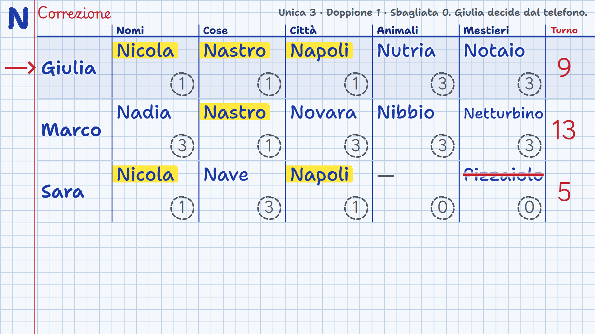
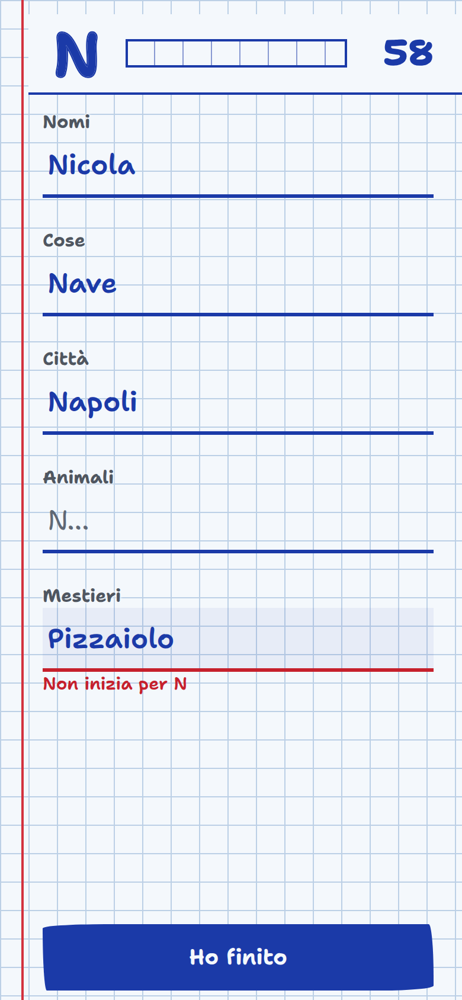

# Giochi da salotto

Una console di giochi per serate in compagnia: la **TV** è il tavolo comune, ogni **telefono** è il foglietto privato. Funziona con un'**app Android** oppure con un **server su PC**.

> **L'app va installata su un solo cellulare, quello che fa da server.** Tutti gli altri giocano dal browser del loro telefono: inquadrano il QR code sulla TV, scrivono il nome e sono dentro, senza installare niente e senza account.

<p align="center">
  
  
</p>

## Chi deve installare cosa

Si può usare in **due modi**: con l'**app Android** oppure con un **server su PC**. Ne basta uno solo, e installa qualcosa **un solo dispositivo**, quello che fa da server.

| Chi | Cosa deve fare |
| --- | --- |
| **Il server** (uno solo) | Installa l'APK su un telefono Android ([guida](docs/App-Android.md)), **oppure** avvia il server su un PC ([guida](docs/Installazione-sul-PC.md)). |
| **Tutti gli altri giocatori** | **Niente da installare.** Con qualsiasi telefono, anche iPhone, inquadrano il QR code e giocano nel browser. |
| **La TV** | **Niente da installare.** Apre `game.local:3000/tv` nel browser. |

## I giochi

- **Nomi, cose e città**: la ruota sceglie la lettera, tutti scrivono 5 parole a tempo, l'amministratore corregge sulla TV.
- **Codice segreto**: lo schermo nasconde 4 pastelli e ognuno prova a indovinarli dal telefono, aiutato dai pallini.
- **L'impiccato**: tutti indovinano la stessa parola, ognuno sul suo telefono; la TV mostra l'omino di ciascuno.
- **Anagrammi**: 8 lettere estratte, più parole possibile; quella trovata solo da te vale doppio.

Fino a 12 giocatori. Regole complete in [Come si gioca](docs/Come-si-gioca.md).

## Come funziona

Un dispositivo fa da **server** e tiene la partita: di solito un telefono con l'app Android, oppure un PC; TV e telefoni lo aprono nel browser, sulla stessa rete Wi-Fi. Non serve internet.

- **Console** (`/console`): accende, cambia o chiude il gioco.
- **TV** (`/tv`): QR code per entrare, ruota, tempo, risposte e classifica.
- **Telefoni** (`/`): ognuno gioca sul suo, in privato. Chi entra come **amministratore** gioca e in più avvia i turni e assegna i punti.

Se un telefono va in standby ritrova posto e punti. Più dettagli in [Come funziona](docs/Come-funziona.md).

## Avviare il server

### Con l'app Android (la strada più semplice)

Non serve un computer: fa tutto un telefono, un tablet o un box Android TV. **L'APK serve solo su quel dispositivo**: gli altri giocatori usano il browser.

Scarica l'APK dalle [release](https://github.com/Pruzzo/giochi-da-salotto/releases/latest), installalo e apri **Giochi da salotto**: il server si accende da solo e mostra la console e il pulsante **Vai a giocare**. Guida completa: [App Android](docs/App-Android.md).

L'app funziona in due modi, e in nessuno dei due serve internet:

- **Wi-Fi di casa**: telefono server, TV e giocatori sullo stesso Wi-Fi.
- **Hotspot del telefono**: dove non c'è un router, il telefono server crea la rete e TV e giocatori si collegano lì.

L'app sceglie la rete da sola e prepara il QR code. Il server si fa trovare nella rete con il nome **`game.local`**: l'indirizzo è sempre `http://game.local:3000`.

### In alternativa, sul PC

Serve [Node.js](https://nodejs.org/) 18 o più recente.

```bash
git clone https://github.com/Pruzzo/giochi-da-salotto.git
cd giochi-da-salotto
npm install
npm start
```

Il terminale stampa gli indirizzi per console, TV e telefoni, per esempio `http://game.local:3000/console`. Guida completa, con firewall e impostazioni: [Installazione sul PC](docs/Installazione-sul-PC.md).

## Documentazione

Tutta la guida, con gli screenshot, è nel [wiki](https://github.com/Pruzzo/giochi-da-salotto/wiki) e nella cartella [`docs/`](docs/Home.md):

1. [Come funziona](docs/Come-funziona.md)
2. [App Android](docs/App-Android.md)
3. [Installazione sul PC](docs/Installazione-sul-PC.md)
4. [Come si gioca](docs/Come-si-gioca.md)
5. [Risoluzione dei problemi](docs/Risoluzione-dei-problemi.md)
6. [Sviluppo](docs/Sviluppo.md)

## Sviluppo

```bash
npm run dev   # riavvia il server a ogni modifica
npm test      # test della logica di gioco
```

Struttura del codice, come aggiungere un gioco e come compilare l'APK: [Sviluppo](docs/Sviluppo.md) e [`android/README.md`](android/README.md).

## Licenze

Il dizionario di Anagrammi deriva da *morph-it!* (CC BY-SA 2.0 e LGPL): dettagli in [`games/anagrammi/data/README.md`](games/anagrammi/data/README.md).
