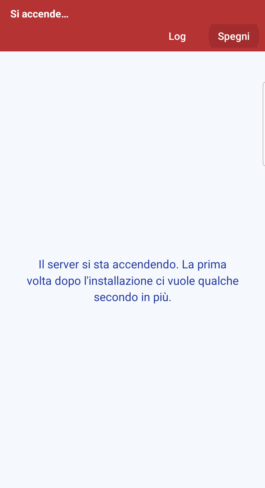
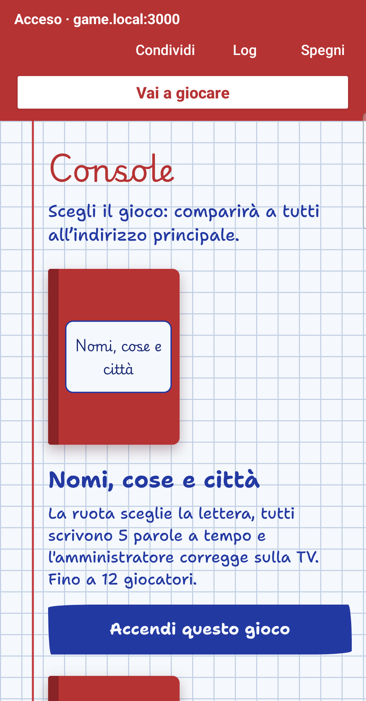
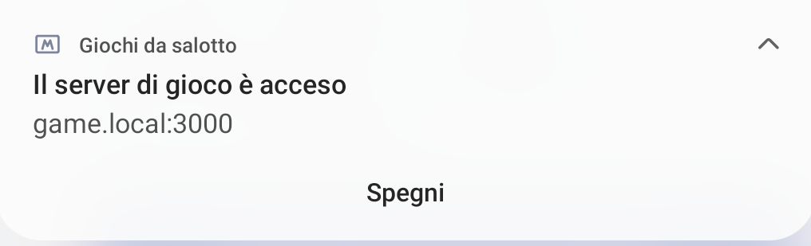
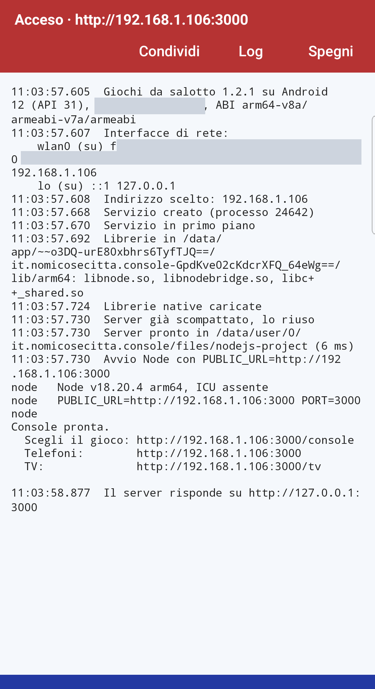

# App Android

Con l'app **Giochi da salotto** un telefono, un tablet o un box Android TV fa da server al posto del PC. Dentro c'è lo stesso server: i giochi, la console e la TV sono identici.

Serve **Android 7 o più recente**. L'app serve solo sul dispositivo che fa da server: gli altri giocatori usano il browser, come sempre.

## Su quale rete funziona

L'app funziona in due modi. **In nessuno dei due serve internet**: la partita resta dentro la rete locale.

| | **Wi-Fi di casa** | **Hotspot del telefono** |
| --- | --- | --- |
| Quando usarlo | Hai un router e tutti sono in casa | Non c'è un router (vacanza, giardino, casa di amici) o il Wi-Fi isola i dispositivi, come le reti ospiti e degli alberghi |
| Chi crea la rete | Il router | Il telefono che fa da server |
| Chi si collega | Telefono server, TV e giocatori, tutti allo stesso Wi-Fi | TV e giocatori, all'hotspot del telefono server |
| Come si fa | Basta aprire l'app | Vedi [Senza Wi-Fi: l'hotspot](#senza-wi-fi-lhotspot) |

Non c'è niente da impostare: l'app sceglie da sola la rete (prima Wi-Fi o cavo, altrimenti hotspot) e mette l'indirizzo giusto sulla barra rossa e nel QR code.

## 1. Scarica l'APK

Apri la pagina delle [release](https://github.com/Pruzzo/giochi-da-salotto/releases/latest) dal telefono che farà da server e scarica uno di questi file:

| File | Per |
| --- | --- |
| `giochi-da-salotto-…-arm64-v8a.apk` | quasi tutti i telefoni dal 2017 in poi |
| `giochi-da-salotto-…-armeabi-v7a.apk` | telefoni vecchi e molti box TV economici |
| `giochi-da-salotto-…-universal.apk` | se non sai quale: va su tutti, ma pesa il doppio |

Se vuoi controllare che il file sia integro, accanto agli APK c'è `SHA256SUMS.txt`.

## 2. Installa

L'app non viene dal Play Store, quindi Android chiede qualche conferma in più:

1. Apri il file scaricato (dalla notifica del download o dall'app *File*).
2. Se compare **"Per motivi di sicurezza, sul telefono non è consentito installare app sconosciute"**, tocca **Impostazioni**, attiva **Consenti da questa fonte** e torna indietro.
3. Tocca **Installa**.
4. Se **Play Protect** avvisa che l'app è sconosciuta, tocca **Altri dettagli → Installa comunque**. L'avviso compare per tutte le app che non passano dal Play Store.

Gli aggiornamenti si installano allo stesso modo, sopra la versione già presente.

## 3. Accendi il server

Apri **Giochi da salotto**. Il server si accende da solo:

  
  

- La prima volta ci vuole qualche secondo in più: l'app prepara i file del server.
- Su Android 13 e successivi l'app chiede di poter mostrare **notifiche**: rispondi **Consenti**, così vedi che il server è acceso e lo spegni dalla notifica.
- Quando è pronto, sulla barra rossa compare **Acceso** con l'indirizzo, per esempio `http://192.168.1.42:3000`, e sotto la **console** per scegliere il gioco.

Sulla barra rossa:

| Pulsante | Cosa fa |
| --- | --- |
| **Condividi** | Manda gli indirizzi per telefoni e TV su WhatsApp, Telegram o dove vuoi. |
| **Log** | Mostra cosa sta facendo il server. Serve se qualcosa non va: vedi sotto. |
| **Spegni** / **Accendi** | Spegne o riaccende il server. Spegnere cancella la partita in corso. |

## 4. Collega TV e giocatori

1. Nella console dell'app tocca **Accendi questo gioco** sotto il gioco che vuoi.
2. Sulla **TV** apri l'indirizzo della barra rossa seguito da `/tv`, per esempio `http://192.168.1.42:3000/tv`. Compare il QR code.
3. I **giocatori** inquadrano il QR code e scrivono il loro nome. Si gioca come sempre: vedi [Come si gioca](Come-si-gioca.md).

Anche chi tiene il telefono server può giocare: apre il browser sullo stesso telefono, va all'indirizzo della barra rossa ed entra con il suo nome.

## Il server a schermo spento

Il server resta acceso anche se spegni lo schermo o passi a un'altra app, finché c'è la sua notifica:

  

L'app tiene il Wi-Fi sveglio a bassa latenza, così i telefoni non sentono ritardi. Ricordati di **spegnerlo** a fine serata (dall'app o dal pulsante **Spegni** della notifica): un server acceso consuma batteria.

Alcuni telefoni (soprattutto Xiaomi, Huawei, Oppo e a volte Samsung) chiudono comunque le app in sottofondo per risparmiare batteria. Se il server si spegne da solo, vedi [Risoluzione dei problemi](Risoluzione-dei-problemi.md#sul-telefono-il-server-si-spegne-da-solo).

## Senza Wi-Fi: l'hotspot

Dove non c'è un router (in vacanza, in giardino, a casa di amici) il telefono server può creare la rete da solo:

1. Sul telefono server attiva l'**hotspot** dalle Impostazioni rapide.
2. Collega all'hotspot la TV e i telefoni dei giocatori.
3. Apri l'app e tocca **Accendi** (o **Spegni** e poi **Accendi**, se era già acceso).

Non serve che ci siano dati mobili: tutto passa dentro l'hotspot.

L'indirizzo dell'hotspot è diverso da quello di casa e cambia da telefono a telefono: leggilo sulla barra rossa, o fai inquadrare il QR code sulla TV.

Se un telefono avvisa che la rete **non ha accesso a internet**, scegli di **restare connesso**. Altrimenti passa ai dati mobili e non vede più il gioco.

Se cambi rete con il server acceso (da Wi-Fi a hotspot o viceversa), spegnilo e riaccendilo: così prende il nuovo indirizzo.

## Su Android TV

L'app si installa anche su televisori e box Android TV e compare tra le app della TV. Lì mostra direttamente lo **schermo della TV** invece della console, e tiene lo schermo acceso durante la partita. La console si apre da un telefono, all'indirizzo `/console`.

Per installare un APK su una TV di solito serve un'app per gestire i file (come *File Commander* o *Downloader*) e il permesso di installare app sconosciute per quell'app, dalle impostazioni di sicurezza della TV.

## Se il server non parte: il Log

Tocca **Log** sulla barra rossa. Il registro si aggiorna da solo e racconta ogni passaggio:

  

- il modello del telefono, la versione di Android e l'architettura;
- le reti trovate e l'indirizzo scelto;
- le librerie caricate e la preparazione dei file del server;
- la versione di Node.js e ogni messaggio del server, compresi gli errori.

Se qualcosa non va: tocca **Spegni** e poi **Accendi** per avere un registro pulito, aspetta qualche secondo, tocca **Copia** e incolla il testo in una [segnalazione](https://github.com/Pruzzo/giochi-da-salotto/issues).

Messaggi comuni:

| Messaggio | Cosa significa |
| --- | --- |
| *Questo dispositivo non è su una rete locale* | Il telefono non è collegato al Wi-Fi e non ha l'hotspot acceso. |
| *Il server non risponde dopo 30 secondi* | Node non è partito: le righe sopra nel Log dicono perché. |
| `EADDRINUSE` | La porta 3000 è già occupata, di solito da un server rimasto a metà. Tocca **Spegni**, poi **Accendi**; se non basta, *Impostazioni → App → Giochi da salotto → Arresto forzato* e riapri l'app. |
