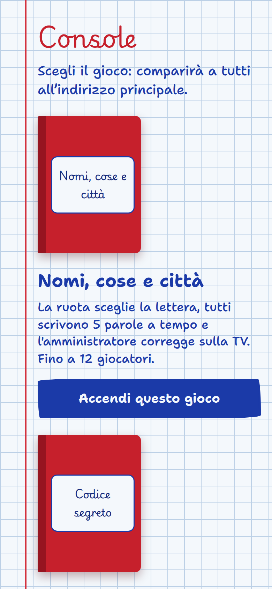
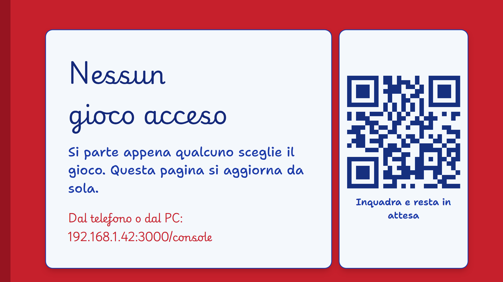

# Come funziona

## I pezzi

```
                  Wi-Fi di casa (o hotspot del telefono server)
   ┌──────────────────────────────────────────────────────────────────┐
   │                                                                  │
   │   SERVER (PC con Node.js, oppure app Android)                    │
   │   http://192.168.1.42:3000                                       │
   │      │                                                           │
   │      ├── /console   chi organizza sceglie il gioco               │
   │      ├── /tv        lo schermo comune: QR code, ruota, classifica│
   │      └── /          i telefoni dei giocatori                     │
   │                                                                  │
   └──────────────────────────────────────────────────────────────────┘
```

- **Server**: tiene la partita in memoria e parla con tutti in tempo reale. È un PC con `npm start` oppure l'app Android. Non serve internet: basta che tutti siano sulla **stessa rete**.
- **Console** (`/console`): da qui si accende un gioco, si cambia gioco o si chiude la partita. La apri da un telefono o dal PC. Non ha password: chiunque sia sulla rete può aprirla.
- **TV** (`/tv`): lo schermo che tutti guardano. Mostra il QR code per entrare, la ruota, il tempo, le risposte da correggere e la classifica. Va bene il browser della smart TV, un PC collegato alla TV in HDMI, un Chromecast con browser, o l'app Android installata su un box TV.
- **Telefoni** (`/`): ogni giocatore entra inquadrando il QR code sulla TV e scrive il suo nome. Il telefono è privato: le risposte restano segrete finché la TV non le svela.

## Gli indirizzi

Il server stampa (o, nell'app, mostra in alto) il suo indirizzo nella rete, per esempio `http://192.168.1.42:3000`:

| Chi | Apre | Esempio |
| --- | --- | --- |
| Chi organizza | indirizzo + `/console` | `http://192.168.1.42:3000/console` |
| La TV | indirizzo + `/tv` | `http://192.168.1.42:3000/tv` |
| I giocatori | l'indirizzo, oppure il QR code sulla TV | `http://192.168.1.42:3000` |

<p align="center">
  
  
</p>

Finché nessun gioco è acceso, TV e telefoni mostrano una pagina d'attesa con il QR code. Quando dalla console accendi un gioco, tutte le pagine passano da sole al gioco: non serve ricaricare nulla.

## I ruoli in una partita

Entrando dal telefono si sceglie un ruolo:

- **Giocatore**: gioca e basta.
- **Amministratore**: gioca anche lui, e in più sceglie le impostazioni (tempo, categorie, difficoltà), avvia i turni e, in *Nomi, cose e città*, conferma i punti. Ne serve uno per partita; se esce, un altro può prenderne il posto.
- **TV**: trasforma quello schermo nella TV del gioco. Utile se la TV non può aprire un indirizzo a mano ma ha una fotocamera, o per usare un tablet come schermo comune.

## Cosa succede se…

- **Un telefono va in standby o perde il Wi-Fi**: quando si riaccende ritrova posto, parole e punti. Il telefono ricorda chi sei finché non tocchi *Esci*.
- **Si cambia gioco dalla console**: la partita in corso si cancella e tutti passano al nuovo gioco, dove rientrano con il nome.
- **Il server si riavvia**: la partita riparte da zero (tutto è in memoria), e i telefoni chiedono di rientrare col nome.
- **Arriva qualcuno a partita iniziata**: può entrare dal QR code in qualsiasi momento.
- **Un giocatore cambia telefono** (batteria scarica…): rientra dal nuovo telefono con lo stesso nome e ritrova i suoi punti.
- **L'amministratore se ne va**: un altro giocatore tocca *Diventa amministratore* e prende il suo posto.

## Cosa serve in rete

- Tutti sulla **stessa rete Wi-Fi** del server, o collegati all'**hotspot** del telefono server.
- La rete non deve isolare i dispositivi tra loro: le reti *ospiti* dei router e molte reti di alberghi lo fanno, e lì i telefoni non vedono il server. Vedi [Risoluzione dei problemi](Risoluzione-dei-problemi.md).
- La porta `3000` del server raggiungibile: sul PC può servire dare il permesso al firewall la prima volta.

Il traffico è HTTP semplice e resta in casa: niente passa da internet, e il server non salva nulla su disco.
