# Come si gioca

Prima di iniziare il server deve essere acceso: dall'[app Android](App-Android.md) o dal [PC](Installazione-sul-PC.md).

## 1. Scegli il gioco dalla console

Apri la **console** (`game.local:3000/console`; nell'app Android è già aperta) tocca il gioco che vuoi e conferma con **Gioca a…** in basso. TV e telefoni passano da soli al gioco scelto.

  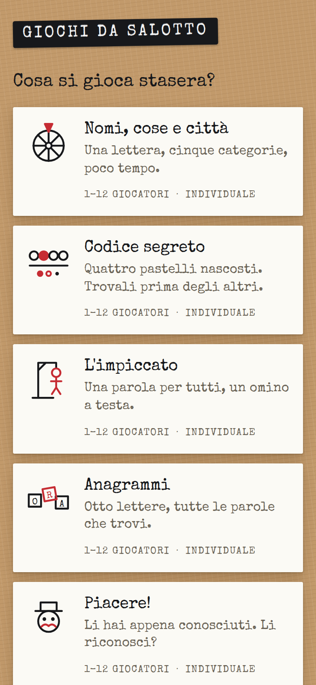
  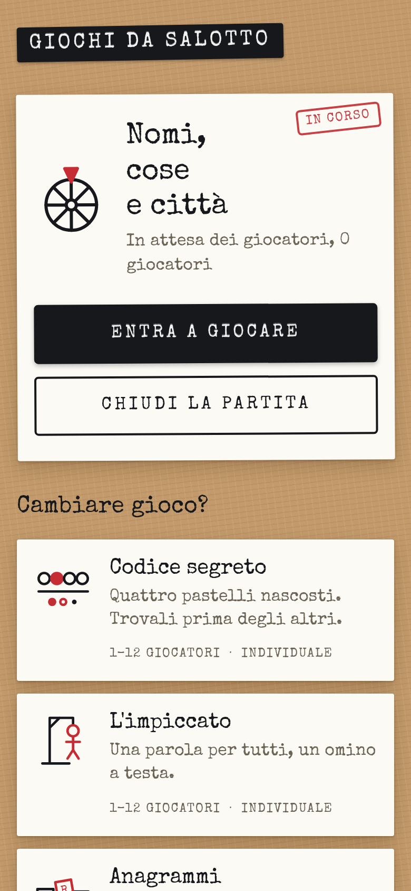

Per cambiare gioco tocca un altro gioco e conferma con **Passa a…**: chi è dentro ci arriva da solo. Per chiudere senza cambiare, **Chiudi la partita**.

Più comodo: il master può cambiare gioco dal suo telefono, senza aprire la console. In sala d'attesa, o a fine partita, tocca **Cambia gioco** e sceglie il gioco nuovo. Tutti ci rientrano da soli con lo stesso nome, e il master resta master. Le stelle della serata restano, i punti della partita lasciata si perdono.

## 2. Entrate dal telefono

I giocatori **non devono installare niente**. La TV mostra il QR code: ognuno lo inquadra con la fotocamera, sceglie il ruolo, scrive il nome e tocca **Entra**.

  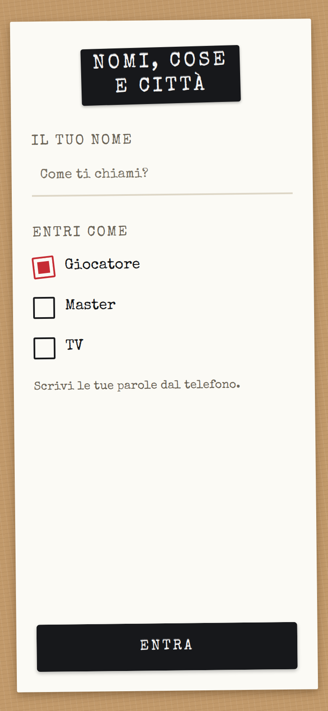
  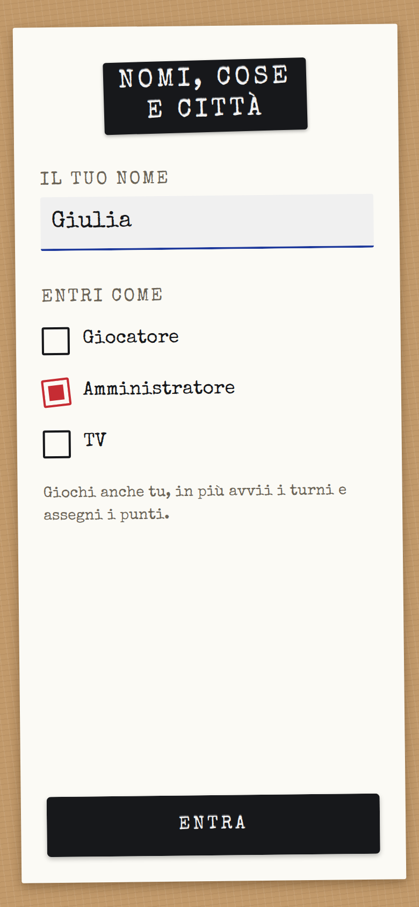

Uno di voi entra come **Master**: gioca come gli altri, e in più sceglie le impostazioni e fa partire i turni.

## 3. Aspettate tutti in sala d'attesa

Chi è entrato compare sulla TV e sui telefoni. Il master sceglie le impostazioni e, quando ci siete tutti, fa partire il primo turno. Dalla sala d'attesa può anche togliere chi è entrato per sbaglio (**Togli**).

  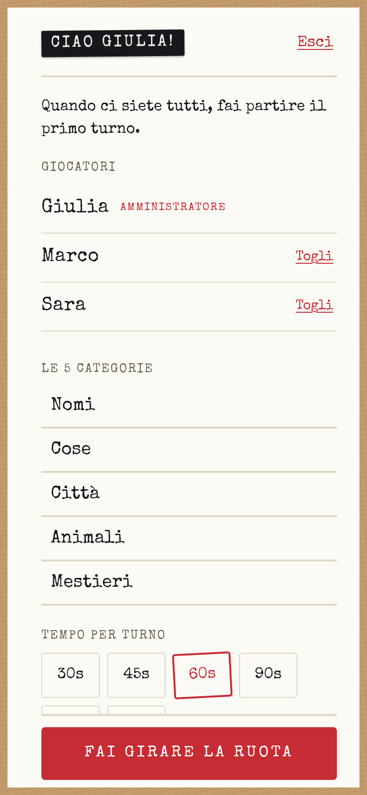
  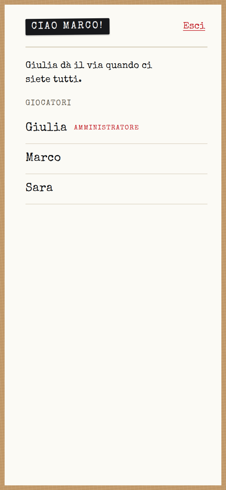

  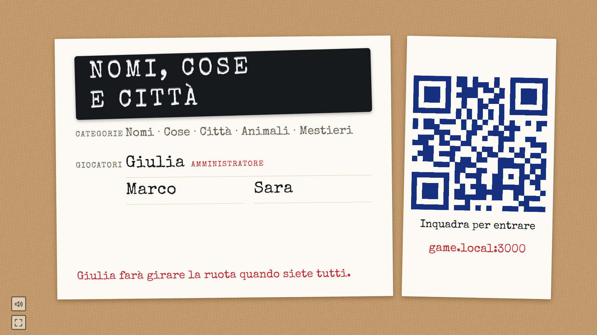

## Le vittorie della serata

Chi vince una partita, a qualunque gioco, prende una **stella**. Le stelle restano anche cambiando gioco, finché il server resta acceso: compaiono accanto ai nomi sulla TV e sui telefoni, nella fine partita, nella console e nella pagina d'attesa tra un gioco e l'altro.

- Vince chi ha più punti quando il master tocca **Fine partita**. A pari merito la stella va a tutti i primi.
- Da soli, o se nessuno ha fatto punti, non vince nessuno.
- Conta il nome: per tenere le tue stelle entra in ogni gioco con lo stesso nome (maiuscole e accenti non contano).
- Spegnendo il server le stelle si azzerano.

---

## Nomi, cose e città

1. In sala d'attesa il master può **rinominare le 5 categorie** (all'inizio Nomi, Cose, Città, Animali, Mestieri) e scegliere il **tempo per turno**, da 30 secondi a 3 minuti.
2. Il master tocca **Fai girare la ruota**. La ruota gira da sola sulla TV e sceglie una lettera non ancora uscita.

   

     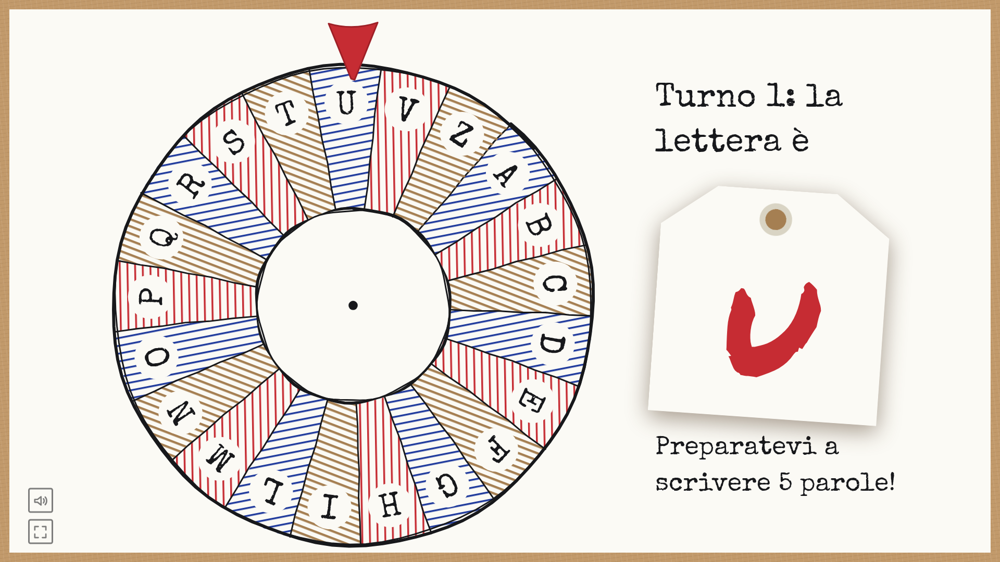
   

3. Tutti scrivono una parola per categoria. Il telefono avvisa se una parola non inizia con la lettera giusta. Le parole restano private fino allo scadere del tempo. Il turno finisce prima se tutti toccano **Ho finito**; il master può anche **fermare il tempo per tutti**.

   

     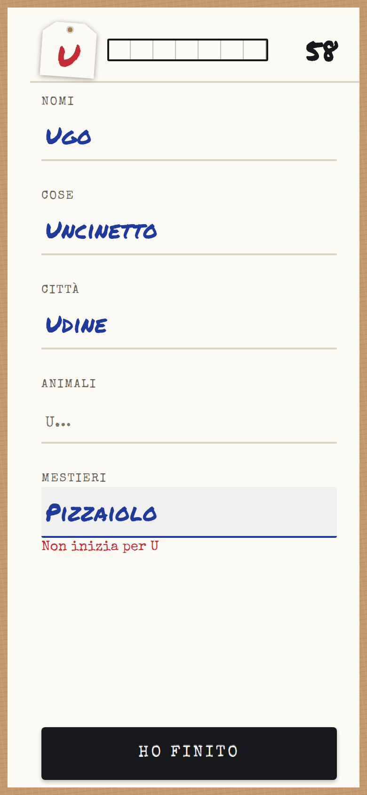
     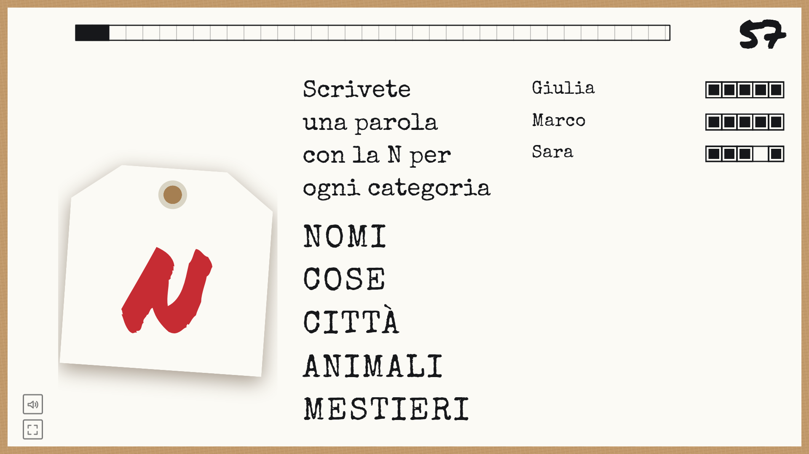
   

4. La TV mostra le parole di tutti. Il gioco propone i punti: **3** per una parola unica, **1** per un doppione, **0** per una parola vuota o con l'iniziale sbagliata. I doppioni sono evidenziati in giallo.

   

     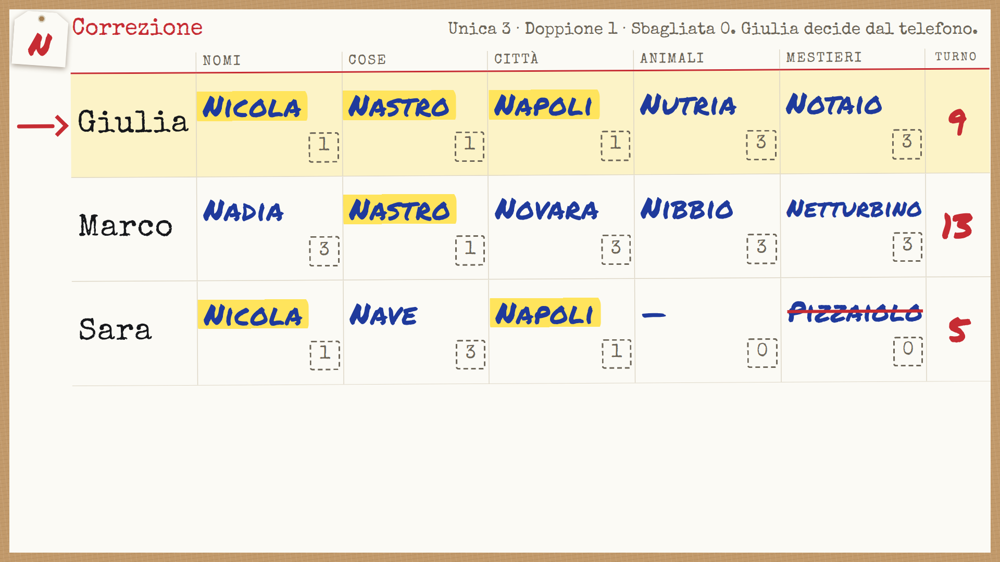
   

5. Il master conferma o cambia i punti dal telefono, giocatore per giocatore, e la TV si aggiorna in diretta. Gli altri vedono sul loro telefono i propri punti.

   

     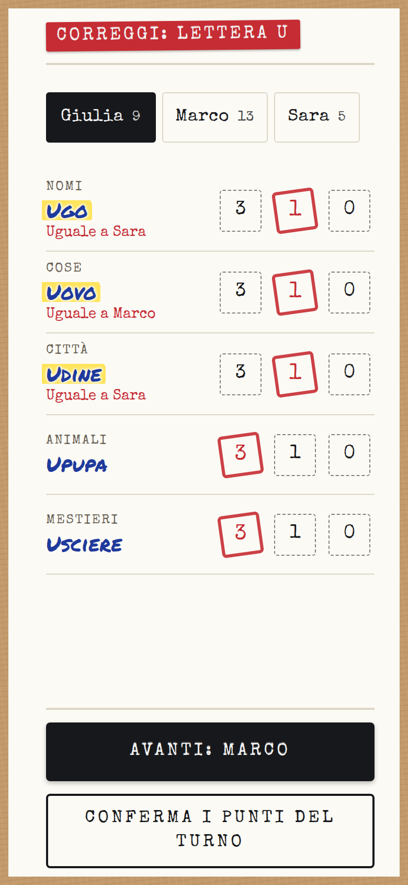
     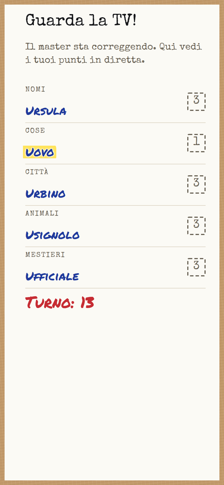
   

6. Con **Conferma i punti del turno** i punti si sommano. Poi il master fa partire un **Nuovo turno** oppure tocca **Fine partita** per la classifica finale.

   

     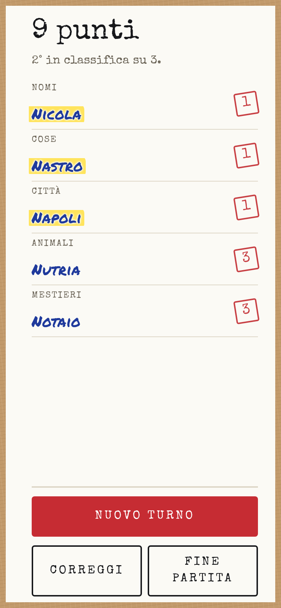
     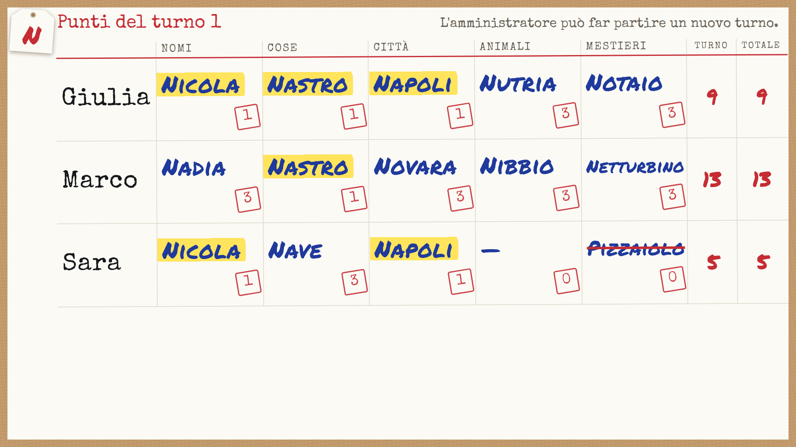
   

## Codice segreto

  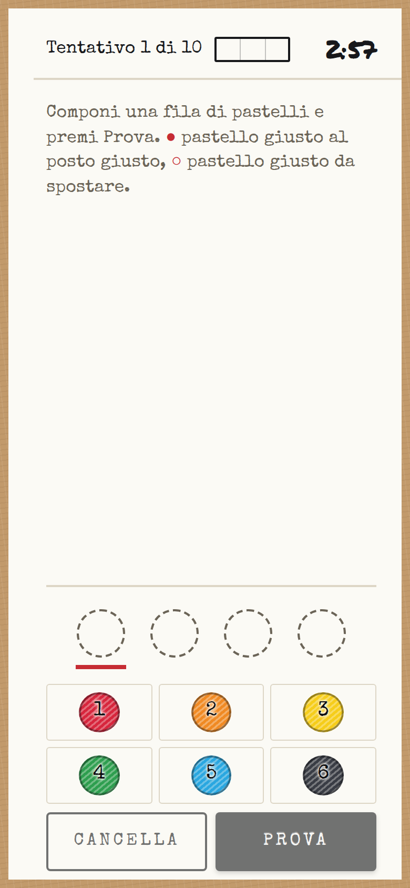
  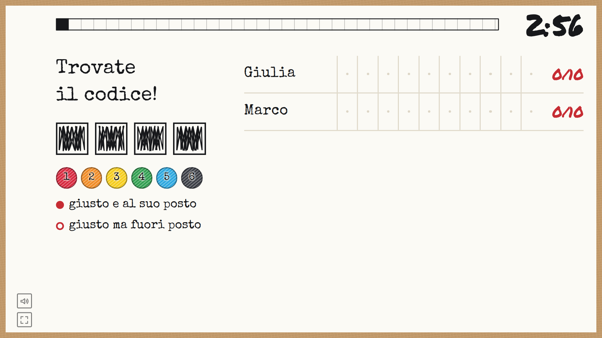

1. Il master sceglie tra quanti pastelli si pesca (6 o 8), se il codice può ripetere un colore e quanto dura il turno (da 2 a 8 minuti).
2. Tocca **Fai scegliere il codice**. Lo schermo sceglie la sequenza a caso: nessuno la conosce, nemmeno il master. Sulla TV quattro pastelli si mescolano e uno scarabocchio li copre.
3. Ognuno compone una fila di 4 pastelli sul telefono e tocca **Prova**. Ogni pastello ha anche un numero, così si distingue senza guardare il colore. Per ogni tentativo arrivano i pallini: **●** pastello giusto al posto giusto, **○** pastello giusto ma da spostare. Si hanno 10 tentativi.
4. La TV mostra a tutti i pallini di ognuno, non i pastelli: si vede chi si sta avvicinando senza poter copiare.
5. Il turno finisce quando tutti hanno trovato il codice o finito i tentativi, quando scade il tempo, o quando il master lo ferma. La TV svela il codice e la fila migliore di ciascuno.
6. **Punti**: chi trova il codice prende 11 meno i tentativi usati (10 al primo colpo, 1 al decimo), più 2 di premio per il primo a trovarlo. Chi non lo trova prende 0.

## L'impiccato

  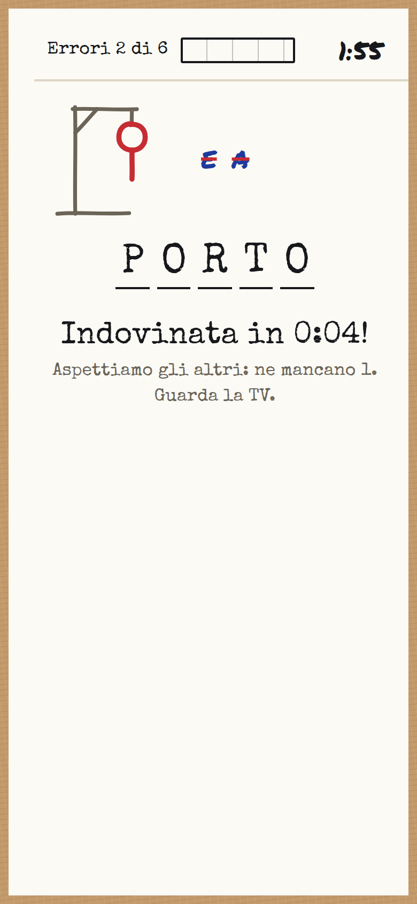
  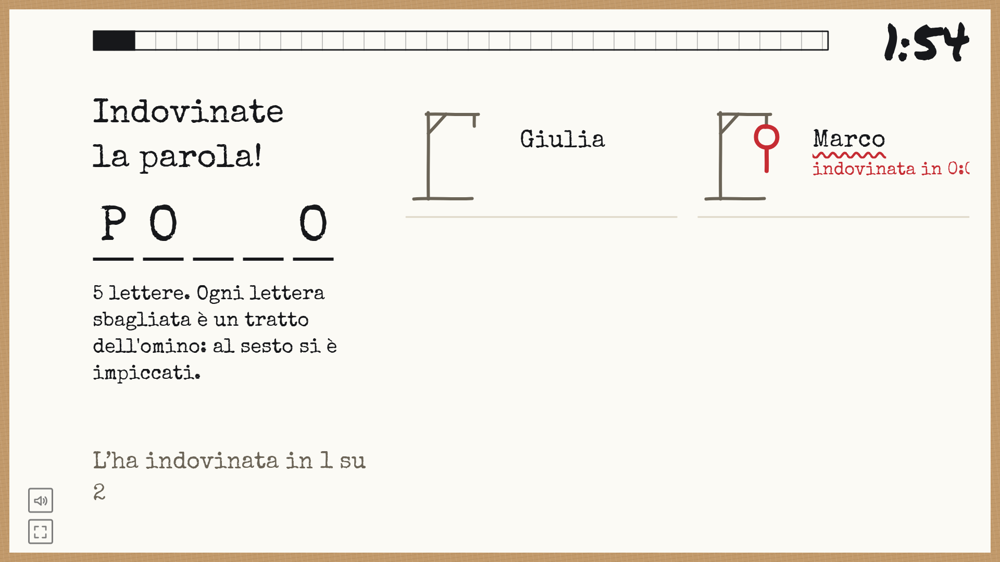

1. Il master sceglie parole corte (fino a 7 lettere), lunghe o di ogni lunghezza e il tempo per turno, poi tocca **Fai scegliere la parola**.
2. Lo schermo sceglie una parola e ne scrive la prima e l'ultima lettera, anche dove si ripetono dentro la parola. Le altre sono caselle vuote.
3. Ognuno gioca sul suo telefono toccando le lettere. Ogni lettera sbagliata aggiunge un tratto all'omino: al sesto si è impiccati. Con **So la parola!** si prova la parola intera; se è sbagliata conta come un errore.
4. La TV mostra il tempo e l'omino di ogni giocatore, con quanti errori ha fatto e se ha indovinato e in quanto tempo. Le lettere degli altri restano segrete fino alla fine.
5. **Punti** per chi indovina: 10, meno 1 per ogni errore, più fino a 5 per la velocità (5 subito, 0 allo scadere). Minimo 1. Chi non indovina o viene impiccato prende 0.

## Anagrammi

  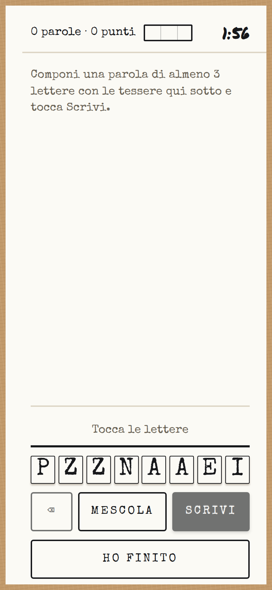
  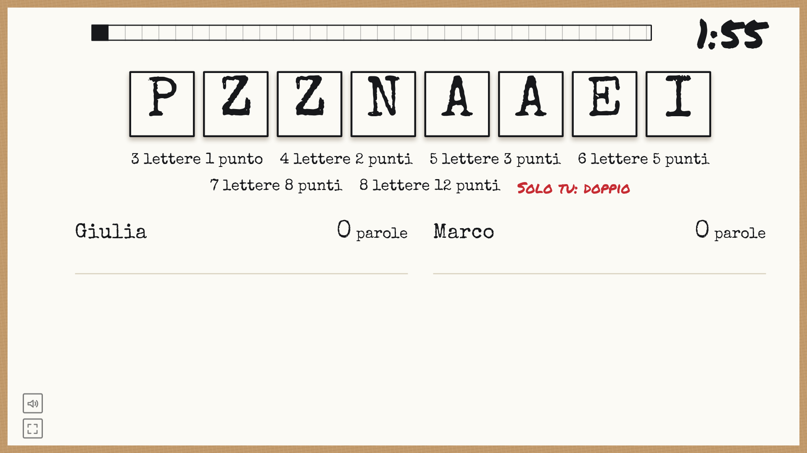

1. Il master sceglie il tempo per turno e tocca **Fai estrarre le lettere**. Lo schermo estrae 8 lettere, prese da una parola comune e mescolate.
2. Ognuno compone parole sul telefono toccando le tessere (con una tastiera vera si può anche scrivere) e tocca **Scrivi**. Ogni tessera si usa una volta sola, le parole devono avere almeno 3 lettere.
3. Il telefono dice subito se la parola vale: deve essere nel dizionario e usare solo le lettere estratte. Le parole sbagliate non costano nulla.
4. La TV mostra quante parole ha ognuno e quanto è lunga la sua migliore, mai quali.
5. **Punti**: 3 lettere 1, 4 lettere 2, 5 lettere 3, 6 lettere 5, 7 lettere 8, 8 lettere 12. Una parola trovata solo da te vale doppio; quelle trovate anche da altri sono evidenziate in giallo.
6. Alla fine la TV mostra la parola di partenza, le più lunghe di ognuno e quelle che nessuno ha trovato.

Il dizionario (circa 63.000 parole con plurali, femminili e verbi coniugati) viene da *morph-it!* di Marco Baroni ed Eros Zanchetta (Università di Bologna), con licenza CC BY-SA 2.0 e LGPL. Fonti e istruzioni per rigenerarlo sono in [`games/anagrammi/data/README.md`](https://github.com/Pruzzo/giochi-da-salotto/blob/main/games/anagrammi/data/README.md).

## Piacere!

  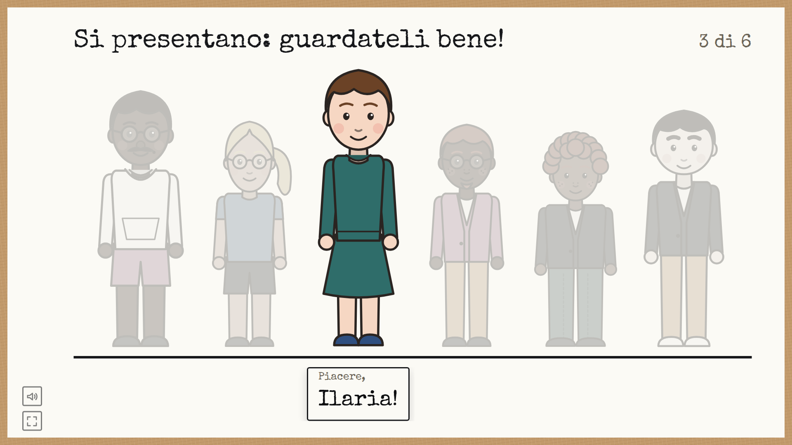
  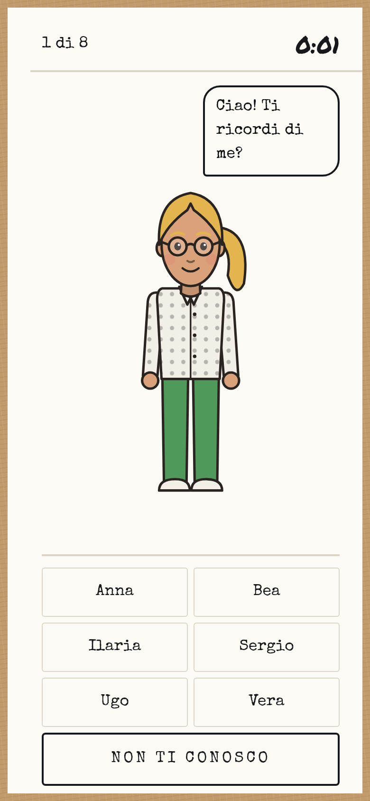

Ognuno per sé: una fila di persone si presenta sulla TV, poi tornano una alla volta sul telefono con altri vestiti. Vince chi le riconosce tutte, prima e senza sbagliare.

1. In sala d'attesa il master sceglie:
   - **quante persone** si presentano: 4, 6, 8 o 10;
   - **quanti sconosciuti** si infilano nella seconda parte: da nessuno a 3;
   - **i vestiti**: *Facile* (gli stessi di prima), *Normale* (vestiti diversi) o *Difficile* (vestiti diversi, a volte cappelli e sciarpe, e sconosciuti che somigliano a qualcuno);
   - **i secondi a presentazione**: 3, 4 o 5.

   

     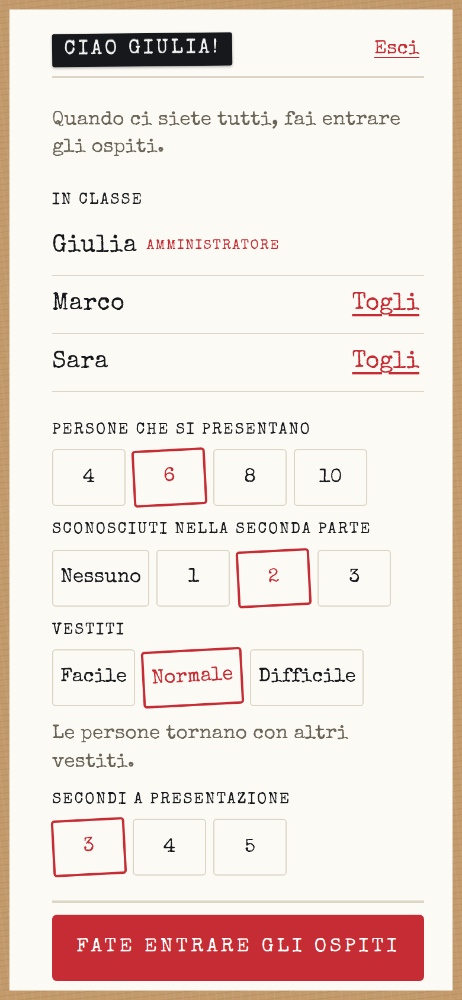
   

2. Il master tocca **Fate entrare gli ospiti**. Sulla TV compare tutta la fila. Poi le persone passano nella luce una alla volta, le altre restano in ombra, e sotto compare il nome: *Piacere, Marta!* Il ritmo è uguale per tutti e i telefoni dicono solo **Guarda la TV**.
3. Ogni persona ha un aspetto suo che non cambia mai: colore della pelle, viso, capelli, barba o baffi, occhiali, lentiggini, corporatura e altezza. Cambiano solo i vestiti. Nella stessa fila due persone si distinguono sempre per almeno tre di questi tratti, e due nomi non cominciano mai con le stesse due lettere.
4. Finite le presentazioni, la TV e i telefoni fanno il conto alla rovescia **3, 2, 1** e il cronometro parte per tutti nello stesso momento. Se i vestiti cambiano, cioè a *Normale* e *Difficile*, compare anche **Occhio ai vestiti!**

   

     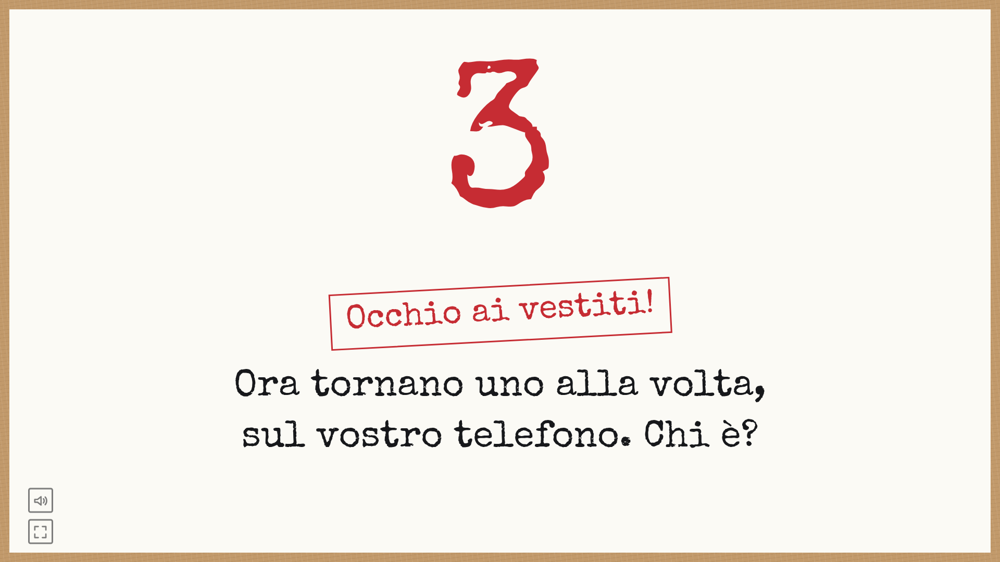
   

5. Sul telefono le persone tornano una alla volta, nello stesso ordine per tutti, con i vestiti della seconda parte. Sotto ci sono tutti i nomi della prima parte, in ordine alfabetico, e il tasto **Non ti conosco**:
   - se scegli il nome giusto, la persona dice *Sì, sono io!*;
   - se sbagli, dice *Ma no, non sono io!*: è un errore, e non scopri il nome giusto;
   - gli sconosciuti, dopo la risposta, si presentano (*Piacere, Ugo!*) e non tornano più. Per loro la risposta giusta è **Non ti conosco**, e toccarlo per una persona già vista è un errore.

   Dopo ogni risposta si passa da soli alla persona dopo. I nomi restano tutti sempre disponibili: lo stesso nome si può dare a più persone.

   

     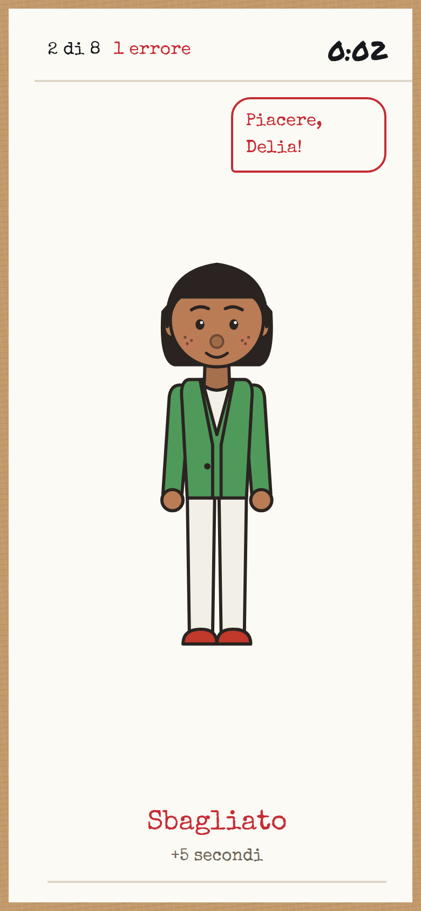
   

6. Sulla TV ogni giocatore ha la sua riga: un pallino pieno per ogni risposta giusta, una croce per ogni errore. Chi arriva in fondo mostra il suo tempo e i secondi di penalità. Il cronometro si ferma a 3 minuti: le persone a cui non hai risposto contano come errori. Chi ha finito, se è il master, può anche **fermare il tempo per tutti**.

   

     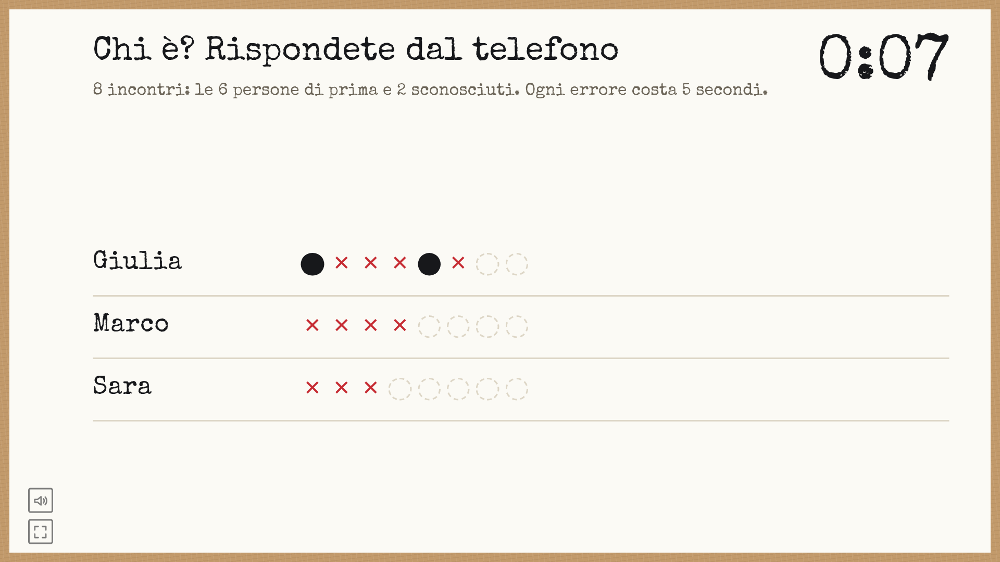
   

7. **Punti**: al tuo tempo si aggiungono **5 secondi per ogni errore**. In classifica si va per tempo totale e i punti vanno per posizione: 10, 8, 6, 5, 4, 3, 2, poi 1 a tutti gli altri. A pari tempo totale, pari punti. Chi non risponde a nessuno prende 0.
8. A fine turno la TV mostra la classifica e accanto la fila della seconda parte: il nome di ognuno, colorato per gli sconosciuti, e quanti giocatori l'hanno riconosciuto. Sul telefono ognuno rivede le sue risposte, una per una. Poi il master tocca **Fate entrare nuovi ospiti**, con persone tutte nuove, oppure **Fine partita**.

   

     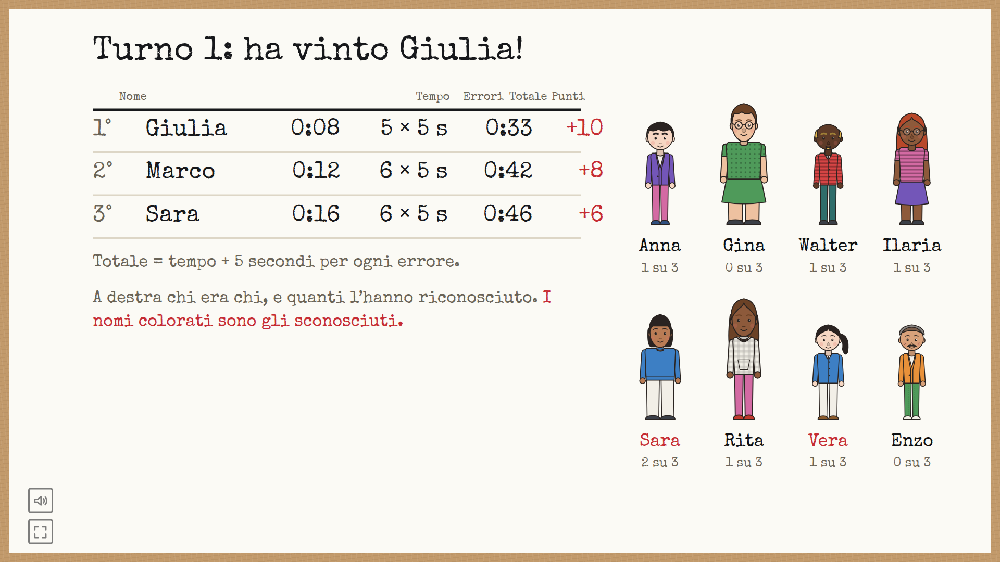
     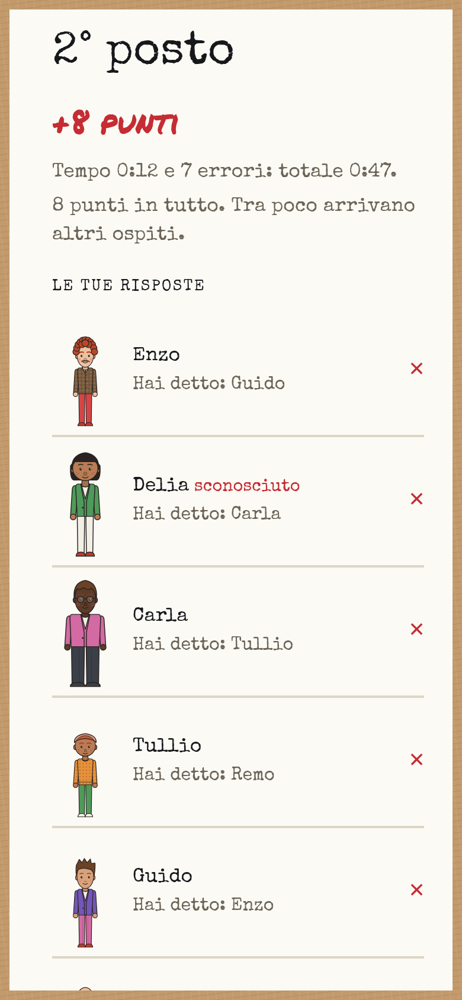
   

Chi entra a turno iniziato aspetta il turno dopo. Chi perde la connessione nella seconda parte rientra dove era rimasto, ma il suo cronometro intanto non si è fermato. Se tutti gli altri hanno finito, il turno si chiude senza aspettarlo.
