# Come si gioca

Prima di iniziare il server deve essere acceso: dall'[app Android](App-Android.md) o dal [PC](Installazione-sul-PC.md).

## 1. Scegli il gioco dalla console

Apri la **console** (`game.local:3000/console`; nell'app Android è già aperta) e tocca **Accendi questo gioco**. TV e telefoni passano da soli al gioco scelto.

  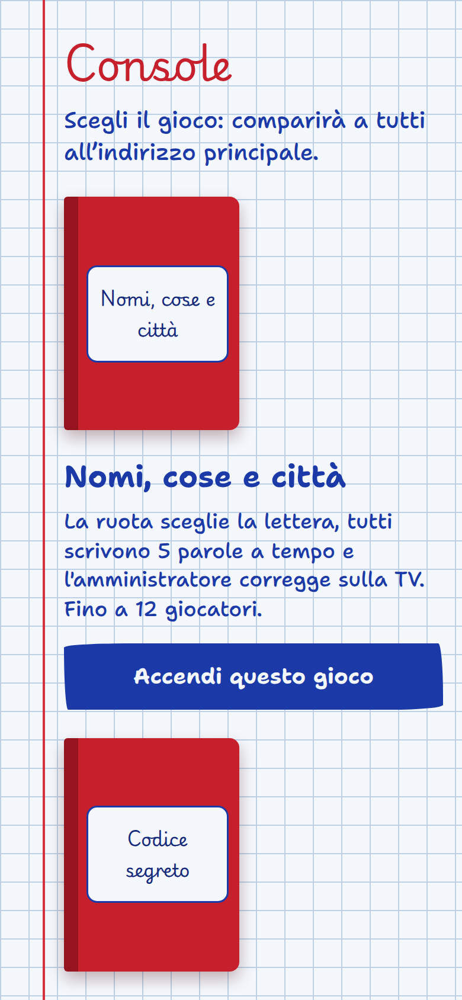
  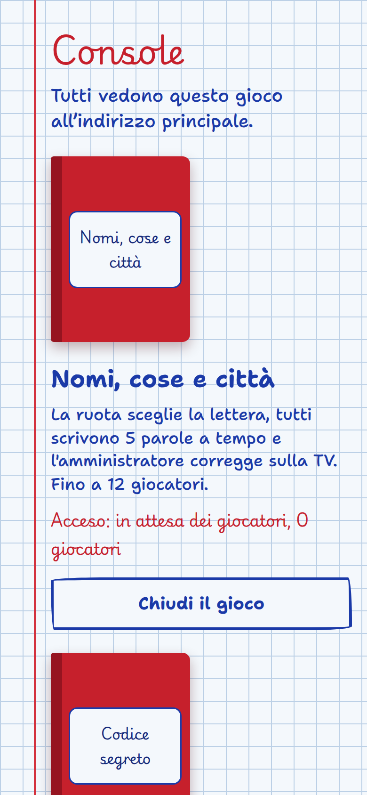

Per cambiare gioco tocca **Chiudi il gioco** e conferma con **Chiudi e cancella la partita**, poi accendi l'altro.

## 2. Entrate dal telefono

I giocatori **non devono installare niente**. La TV mostra il QR code: ognuno lo inquadra con la fotocamera, sceglie il ruolo, scrive il nome e tocca **Entra**.

  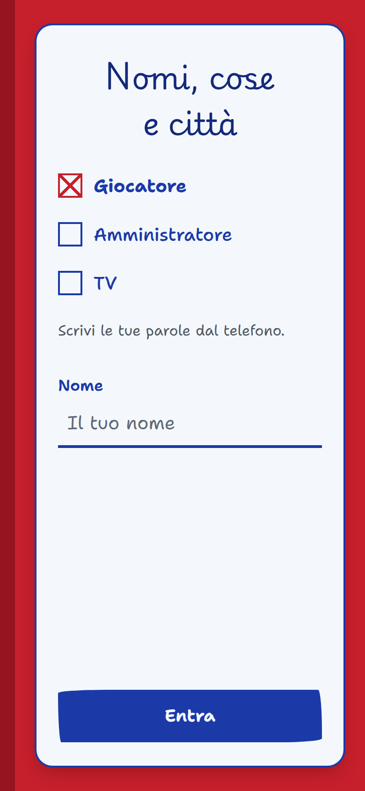
  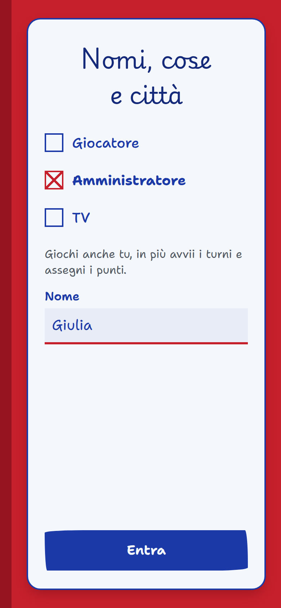

Uno di voi entra come **Amministratore**: gioca come gli altri, e in più sceglie le impostazioni e fa partire i turni.

## 3. Aspettate tutti in classe

Chi è entrato compare sulla TV e sui telefoni. L'amministratore sceglie le impostazioni e, quando ci siete tutti, fa partire il primo turno. Dalla sala d'attesa può anche togliere chi è entrato per sbaglio (**Togli**).

  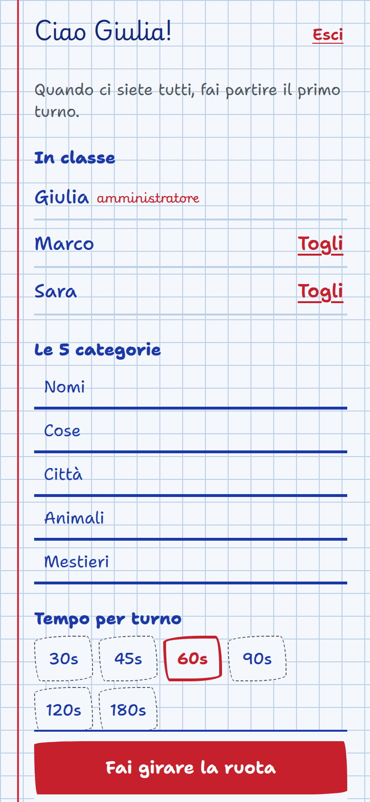
  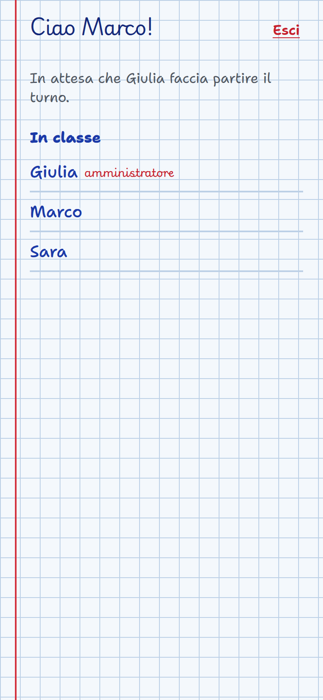

  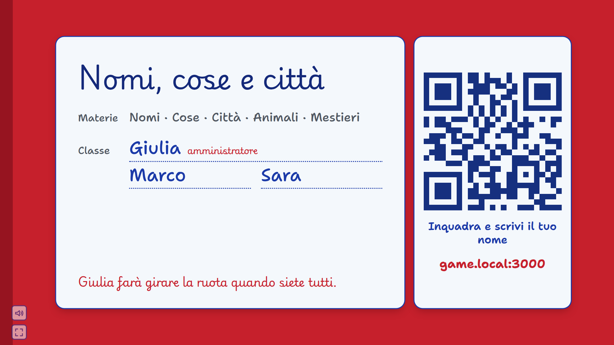

---

## Nomi, cose e città

1. In sala d'attesa l'amministratore può **rinominare le 5 categorie** (all'inizio Nomi, Cose, Città, Animali, Mestieri) e scegliere il **tempo per turno**, da 30 secondi a 3 minuti.
2. L'amministratore tocca **Fai girare la ruota**. La ruota gira da sola sulla TV e sceglie una lettera non ancora uscita.

   

     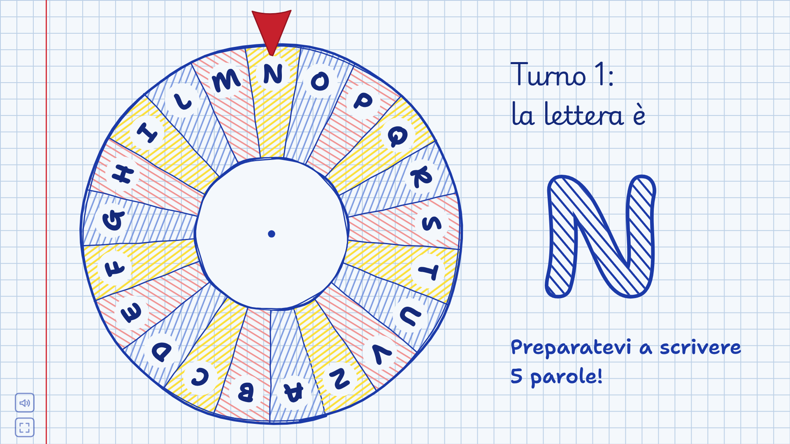
   

3. Tutti scrivono una parola per categoria. Il telefono avvisa se una parola non inizia con la lettera giusta. Le parole restano private fino allo scadere del tempo. Il turno finisce prima se tutti toccano **Ho finito**; l'amministratore può anche **fermare il tempo per tutti**.

   

     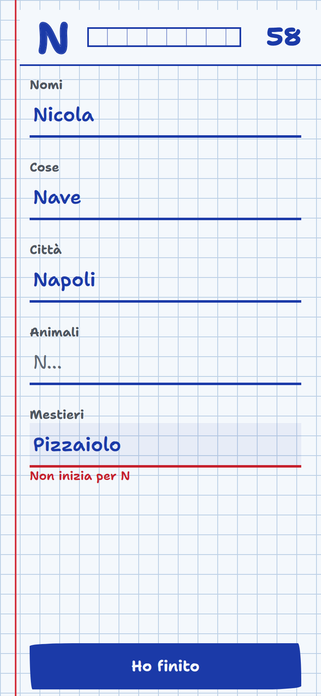
     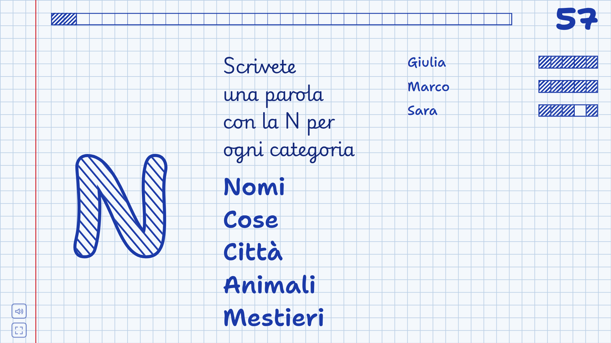
   

4. La TV mostra le parole di tutti. Il gioco propone i punti: **3** per una parola unica, **1** per un doppione, **0** per una parola vuota o con l'iniziale sbagliata. I doppioni sono evidenziati in giallo.

   

     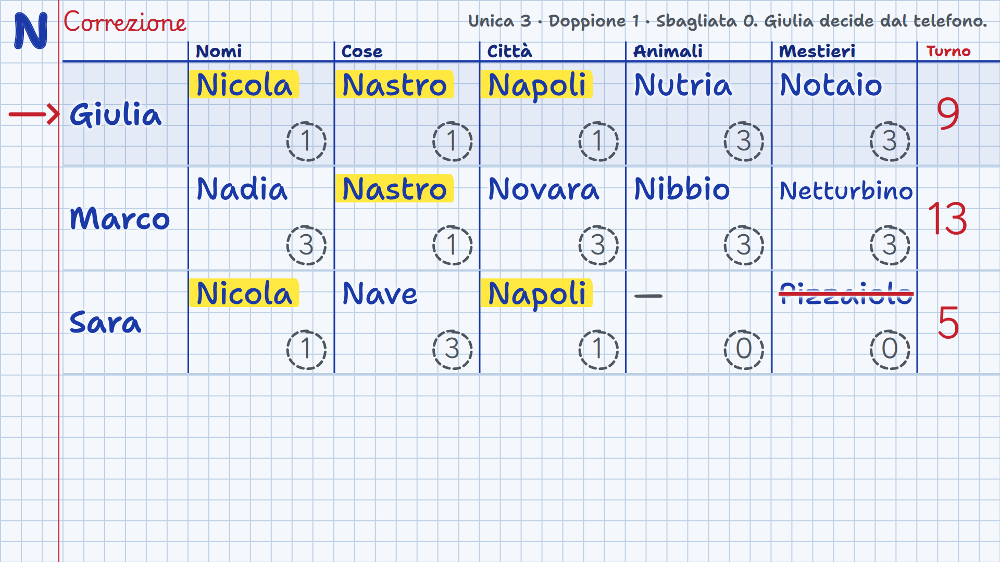
   

5. L'amministratore conferma o cambia i punti dal telefono, giocatore per giocatore, e la TV si aggiorna in diretta. Gli altri vedono sul loro telefono i propri punti.

   

     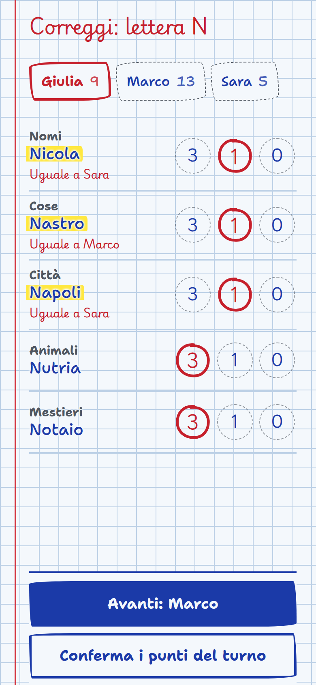
     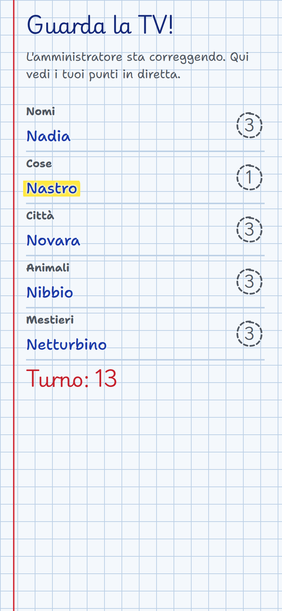
   

6. Con **Conferma i punti del turno** i punti si sommano. Poi l'amministratore fa partire un **Nuovo turno** oppure tocca **Fine partita** per la classifica finale.

   

     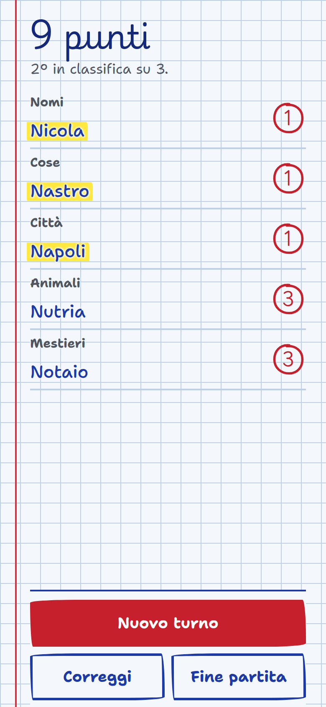
     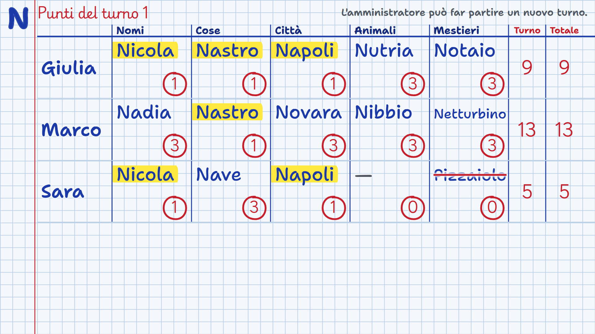
   

## Codice segreto

  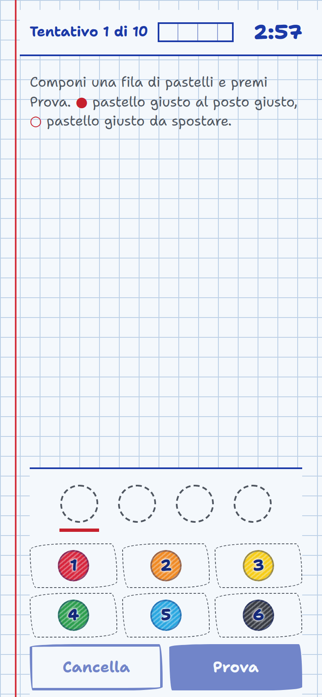
  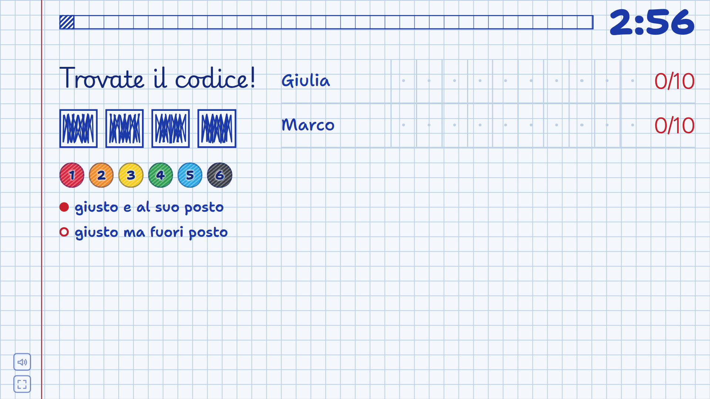

1. L'amministratore sceglie tra quanti pastelli si pesca (6 o 8), se il codice può ripetere un colore e quanto dura il turno (da 2 a 8 minuti).
2. Tocca **Fai scegliere il codice**. Lo schermo sceglie la sequenza a caso: nessuno la conosce, nemmeno l'amministratore. Sulla TV quattro pastelli si mescolano e uno scarabocchio li copre.
3. Ognuno compone una fila di 4 pastelli sul telefono e tocca **Prova**. Ogni pastello ha anche un numero, così si distingue senza guardare il colore. Per ogni tentativo arrivano i pallini: **●** pastello giusto al posto giusto, **○** pastello giusto ma da spostare. Si hanno 10 tentativi.
4. La TV mostra a tutti i pallini di ognuno, non i pastelli: si vede chi si sta avvicinando senza poter copiare.
5. Il turno finisce quando tutti hanno trovato il codice o finito i tentativi, quando scade il tempo, o quando l'amministratore lo ferma. La TV svela il codice e la fila migliore di ciascuno.
6. **Punti**: chi trova il codice prende 11 meno i tentativi usati (10 al primo colpo, 1 al decimo), più 2 di premio per il primo a trovarlo. Chi non lo trova prende 0.

## L'impiccato

  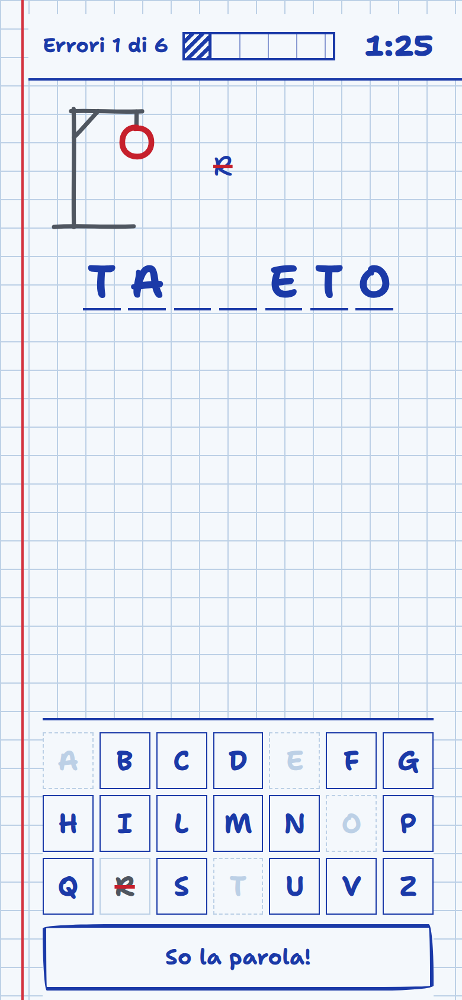
  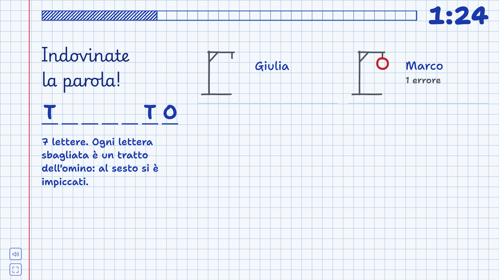

1. L'amministratore sceglie parole corte (fino a 7 lettere), lunghe o di ogni lunghezza e il tempo per turno, poi tocca **Fai scegliere la parola**.
2. Lo schermo sceglie una parola e ne scrive la prima e l'ultima lettera, anche dove si ripetono dentro la parola. Le altre sono caselle vuote.
3. Ognuno gioca sul suo telefono toccando le lettere. Ogni lettera sbagliata aggiunge un tratto all'omino: al sesto si è impiccati. Con **So la parola!** si prova la parola intera; se è sbagliata conta come un errore.
4. La TV mostra il tempo e l'omino di ogni giocatore, con quanti errori ha fatto e se ha indovinato e in quanto tempo. Le lettere degli altri restano segrete fino alla fine.
5. **Punti** per chi indovina: 10, meno 1 per ogni errore, più fino a 5 per la velocità (5 subito, 0 allo scadere). Minimo 1. Chi non indovina o viene impiccato prende 0.

## Anagrammi

  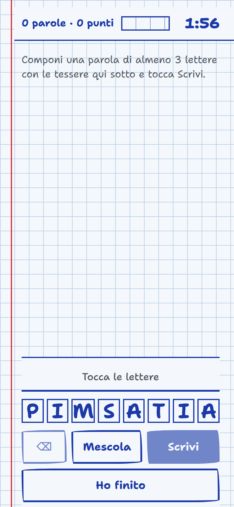
  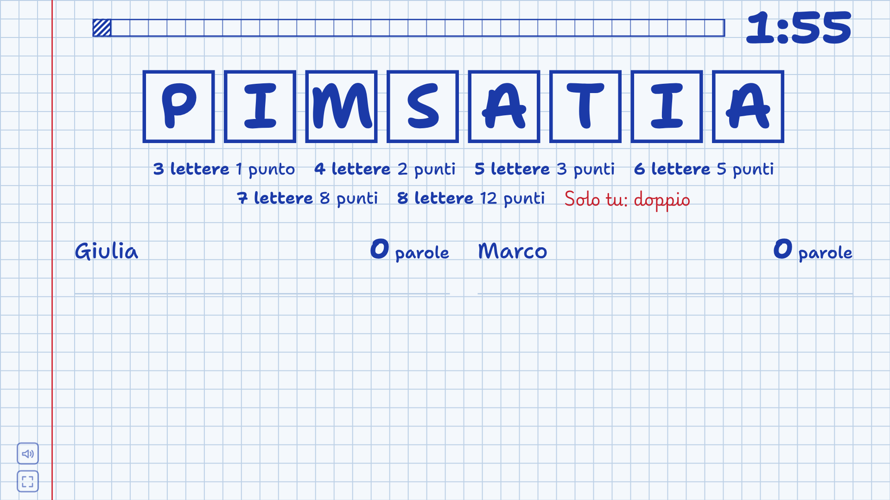

1. L'amministratore sceglie il tempo per turno e tocca **Fai estrarre le lettere**. Lo schermo estrae 8 lettere, prese da una parola comune e mescolate.
2. Ognuno compone parole sul telefono toccando le tessere (con una tastiera vera si può anche scrivere) e tocca **Scrivi**. Ogni tessera si usa una volta sola, le parole devono avere almeno 3 lettere.
3. Il telefono dice subito se la parola vale: deve essere nel dizionario e usare solo le lettere estratte. Le parole sbagliate non costano nulla.
4. La TV mostra quante parole ha ognuno e quanto è lunga la sua migliore, mai quali.
5. **Punti**: 3 lettere 1, 4 lettere 2, 5 lettere 3, 6 lettere 5, 7 lettere 8, 8 lettere 12. Una parola trovata solo da te vale doppio; quelle trovate anche da altri sono evidenziate in giallo.
6. Alla fine la TV mostra la parola di partenza, le più lunghe di ognuno e quelle che nessuno ha trovato.

Il dizionario (circa 63.000 parole con plurali, femminili e verbi coniugati) viene da *morph-it!* di Marco Baroni ed Eros Zanchetta (Università di Bologna), con licenza CC BY-SA 2.0 e LGPL. Fonti e istruzioni per rigenerarlo sono in [`games/anagrammi/data/README.md`](https://github.com/Pruzzo/giochi-da-salotto/blob/main/games/anagrammi/data/README.md).
