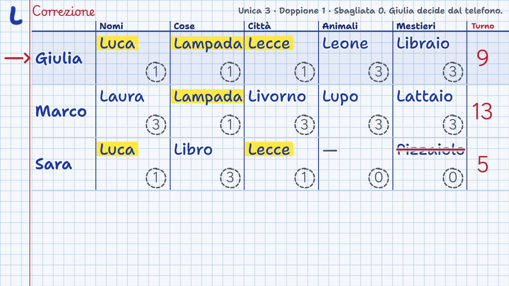
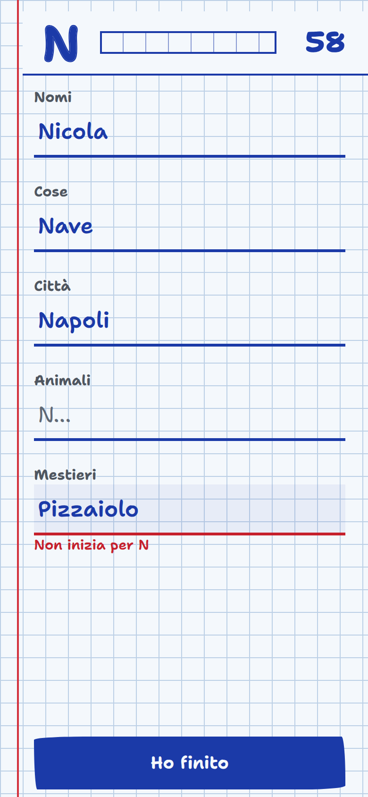

# Giochi da salotto

Una console di giochi per serate in compagnia: la **TV** è il tavolo comune che tutti guardano, ogni **telefono** è il foglietto privato su cui si gioca. Funziona con un'**app Android** oppure con un **server su PC**. Installa qualcosa solo chi fa da server: tutti gli altri inquadrano un QR code e giocano, senza app e senza account.

  
  

## Chi deve installare cosa

Si può usare in **due modi**: con l'**app Android** oppure con un **server su PC**. Ne basta uno solo, e installa qualcosa **un solo dispositivo**, quello che fa da server.

| Chi | Cosa deve fare |
| --- | --- |
| **Il server** (uno solo) | Installa l'APK su un telefono Android ([guida](App-Android.md)), **oppure** avvia il server su un PC ([guida](Installazione-sul-PC.md)). |
| **Tutti gli altri giocatori** | **Niente da installare.** Con qualsiasi telefono, anche iPhone, inquadrano il QR code e giocano nel browser. |
| **La TV** | **Niente da installare.** Apre un indirizzo nel browser. |

## I giochi

| Gioco | In breve |
| --- | --- |
| **Nomi, cose e città** | La ruota sceglie la lettera, tutti scrivono 5 parole a tempo, l'amministratore corregge sulla TV. |
| **Codice segreto** | Lo schermo nasconde 4 pastelli; ognuno prova a indovinarli dal telefono con l'aiuto dei pallini. |
| **L'impiccato** | Ognuno indovina la stessa parola sul suo telefono, la TV mostra l'omino di tutti. |
| **Anagrammi** | 8 lettere estratte, più parole possibile in tempo; vale doppio quella trovata solo da te. |

Fino a 12 giocatori per partita. Regole complete in [Come si gioca](Come-si-gioca.md).

## Chi fa da server

Serve un dispositivo che tenga la partita: il **server**. Telefoni e TV si collegano a lui sulla stessa rete. La strada più semplice è l'**app Android**: non serve un computer.

| | **Telefono o box Android** (consigliato) | **PC** |
| --- | --- | --- |
| Cosa serve | L'app *Giochi da salotto* (APK) | Un computer con Node.js 18+ |
| Installazione | Scarichi l'APK e lo apri | `npm install`, poi `npm start` |
| Rete | [Wi-Fi di casa **oppure** hotspot del telefono](App-Android.md#su-quale-rete-funziona) | Wi-Fi di casa |
| Guida | [App Android](App-Android.md) | [Installazione sul PC](Installazione-sul-PC.md) |

In tutti e due i casi i giochi sono gli stessi e TV e telefoni li aprono nel browser.

## Le pagine di questa guida

1. [Come funziona](Come-funziona.md): server, console, TV e telefoni, e cosa serve in rete.
2. [App Android](App-Android.md): un telefono o un box TV fa da server, anche senza Wi-Fi di casa.
3. [Installazione sul PC](Installazione-sul-PC.md): Windows, macOS e Linux, passo per passo.
4. [Come si gioca](Come-si-gioca.md): dall'accensione alla classifica, con le regole di ogni gioco.
5. [Risoluzione dei problemi](Risoluzione-dei-problemi.md): i telefoni non entrano, il QR porta altrove, il server si spegne.
6. [Sviluppo](Sviluppo.md): com'è fatto il codice, come aggiungere un gioco, come compilare l'APK.
