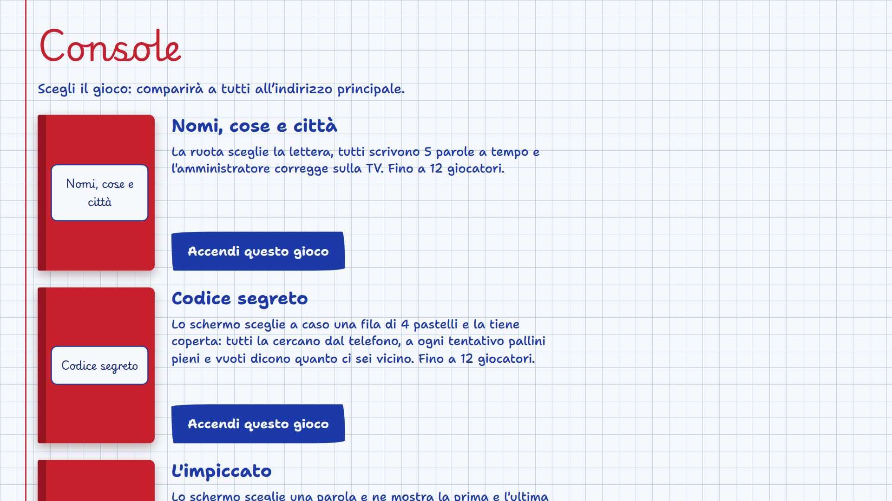
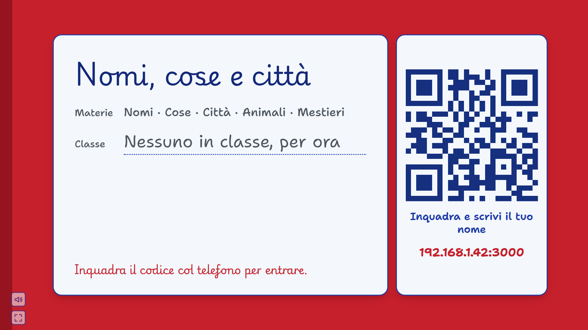

# Installazione sul PC

Se non vuoi usare l'[app Android](App-Android.md), può fare da server un PC: i giochi sono gli stessi. Il PC va acceso durante la partita e collegato alla stessa rete Wi-Fi di TV e telefoni (via cavo o Wi-Fi, è uguale). Funziona su Windows, macOS e Linux.

> **Si installa solo sul PC.** Con il server su PC non serve nemmeno l'APK: i giocatori inquadrano il QR code e giocano nel browser, e la TV apre un indirizzo.

## 1. Installa Node.js

Serve **Node.js 18 o più recente**.

- **Windows e macOS**: scarica il programma di installazione "LTS" da [nodejs.org](https://nodejs.org/) e segui i passaggi predefiniti.
- **Linux**: usa il gestore di pacchetti della tua distribuzione oppure [nvm](https://github.com/nvm-sh/nvm):

  ```bash
  nvm install --lts
  ```

Per controllare, apri un terminale (su Windows: *Prompt dei comandi* o *PowerShell*) e scrivi:

```bash
node --version
```

Deve rispondere `v18` o un numero più alto.

## 2. Scarica il gioco

Con git:

```bash
git clone https://github.com/Pruzzo/giochi-da-salotto.git
cd giochi-da-salotto
```

Senza git: sulla pagina del repository tocca **Code → Download ZIP**, estrai l'archivio e apri un terminale dentro la cartella estratta.

## 3. Installa le dipendenze

Una volta sola (e di nuovo dopo ogni aggiornamento):

```bash
npm install
```

## 4. Avvia il server

```bash
npm start
```

Il terminale risponde con i tre indirizzi da usare:

```
Console pronta.
  Scegli il gioco: http://192.168.1.42:3000/console
  Telefoni:        http://192.168.1.42:3000
  TV:              http://192.168.1.42:3000/tv
```

**Lascia aperto il terminale** per tutta la partita: chiuderlo (o premere `Ctrl+C`) spegne il server e cancella la partita.

La prima volta il sistema può chiedere il permesso di rete:

- **Windows**: compare *Windows Defender Firewall*. Spunta **Reti private** e tocca **Consenti accesso**. Se l'hai negato per sbaglio, vedi [Risoluzione dei problemi](Risoluzione-dei-problemi.md#il-firewall-del-pc-blocca-i-telefoni).
- **macOS**: alla domanda "Vuoi che node accetti connessioni in entrata?" rispondi **Consenti**.

## 5. Accendi un gioco e collega la TV

1. Apri l'indirizzo della **console** dal browser del PC o da un telefono e tocca **Accendi questo gioco** sotto il gioco che vuoi.

   

2. Sulla **TV** apri l'indirizzo che finisce con `/tv`. Compare la copertina del gioco con il QR code:

   

   Per avere lo schermo intero tocca l'icona in basso a sinistra.

3. I **giocatori** inquadrano il QR code con la fotocamera del telefono e scrivono il loro nome. Da lì in poi si gioca: vedi [Come si gioca](Come-si-gioca.md).

## Impostazioni

Si passano come variabili d'ambiente prima di `npm start`:

| Variabile | Predefinito | A cosa serve |
| --- | --- | --- |
| `PORT` | `3000` | La porta del server |
| `PUBLIC_URL` | rilevato dalla rete | L'indirizzo scritto nel QR code, se quello rilevato è sbagliato |

Esempi:

```bash
# Linux e macOS
PORT=8080 npm start
PUBLIC_URL=http://192.168.1.50:3000 npm start
```

```powershell
# Windows (PowerShell)
$env:PUBLIC_URL="http://192.168.1.50:3000"; npm start
```

Il server sceglie da solo l'indirizzo del Wi-Fi di casa e scarta Docker e VPN. Serve `PUBLIC_URL` solo quando il PC ha più reti e il QR code porta a quella sbagliata: per trovare l'indirizzo giusto vedi [Risoluzione dei problemi](Risoluzione-dei-problemi.md#il-qr-code-porta-a-un-indirizzo-sbagliato).

## Aggiornare

```bash
git pull        # oppure scarica di nuovo lo ZIP
npm install
npm start
```
